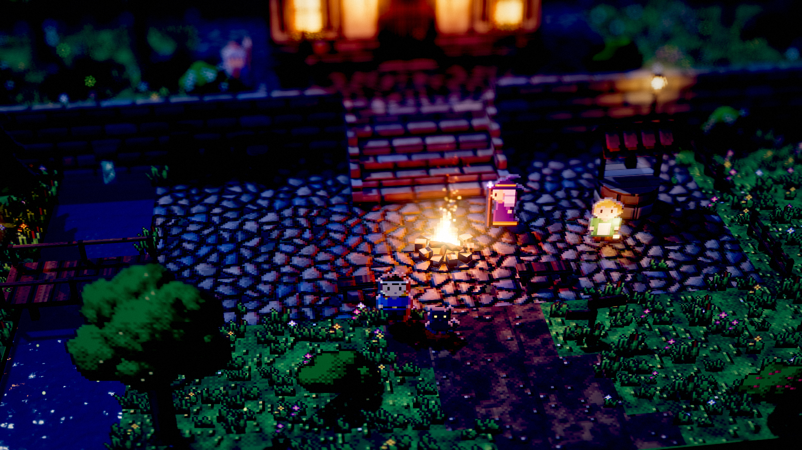
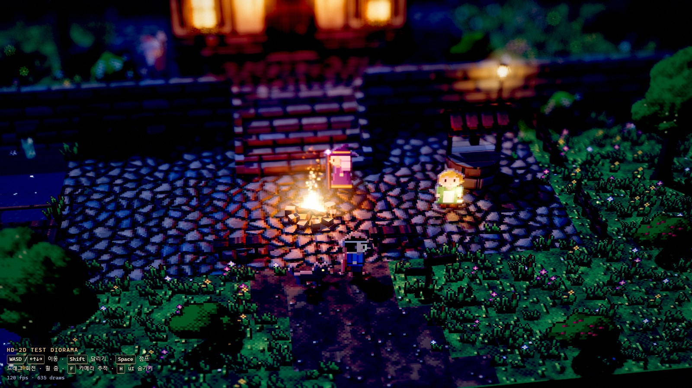

<div align="center">

# HD-2D Diorama

Three.js로 만든 작은 픽셀 세계를 직접 걸어보는 브라우저 디오라마입니다.

[](https://legerdo.github.io/hd2d-diorama/)


</div>

## 스크린샷

<p align="center">
  
  
</p>

## 소개

복셀 형태의 3D 마을과 카메라를 바라보는 픽셀 캐릭터를 한 장면에 담았습니다. 횃불과 반딧불이 빛나는 마을을 탐험하고, 조명과 화면 효과를 직접 조정할 수 있습니다.

### 주요 기능

- 픽셀 텍스처와 빌보드 캐릭터를 결합한 HD-2D 장면
- 횃불 그림자, 불씨, 연기, 반딧불이, 움직이는 폭포
- Bloom과 틸트 시프트 심도를 포함한 후처리
- 조명 프리셋과 렌더링 옵션을 조정하는 실시간 패널

### 조작

| 입력 | 동작 |
| --- | --- |
| `W` `A` `S` `D` 또는 방향키 | 이동 |
| `Shift` | 달리기 |
| `Space` | 점프 |
| 마우스 드래그 | 카메라 회전 |
| 마우스 휠 | 확대 / 축소 |
| `F` | 카메라 추적 켜기 / 끄기 |
| `H` | 조작 안내와 설정 패널 숨기기 / 표시 |

## 로컬에서 실행하기

**필요 환경:** Node.js `20.19.x` 또는 `22.12+`

```bash
npm install
npm run dev
```

Windows에서는 프로젝트 폴더의 `run.bat`을 더블클릭해도 실행할 수 있습니다.

## 기술 스택

- [Three.js](https://threejs.org/) · WebGL 렌더링
- [Vite](https://vite.dev/) · 개발 서버와 빌드
- JavaScript · 프로시저럴 픽셀 아트 및 장면 구성

## GitHub Pages

[라이브 데모 열기](https://legerdo.github.io/hd2d-diorama/)

사이트는 `main` 브랜치의 `/docs` 폴더에서 제공됩니다. 배포 파일은 `npm run build` 결과물이며, 앱의 정적 자산 경로는 프로젝트 경로 배포에 맞춰져 있습니다.
